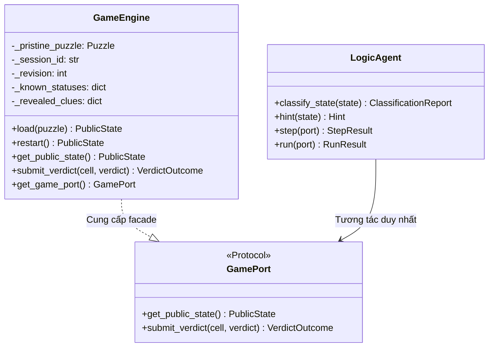

# Báo cáo phần A — Mô hình hóa bài toán và Giao thức suy luận (report/A-formulation.md)

Tài liệu này trình bày chi tiết phần mô hình hóa bài toán (Problem Formulation), ngữ nghĩa của 8 mẫu clue, cấu trúc cơ sở tri thức (Knowledge Base) và giao thức lật bài (Reveal Protocol) của Griductive Solver.

---

## 1. Biến mệnh đề (Propositional Variables)

Xét bảng Griductive kích thước $n \times n$ ($n \in \{3, 4, 5\}$). Mỗi ô trên bảng được xác định bởi tọa độ chuẩn:
- Cột $c \in \{0, \dots, n-1\}$ tương ứng với chữ cái ('A', 'B', 'C', ...).
- Hàng $r \in \{0, \dots, n-1\}$ tương ứng với số thứ tự (1, 2, 3, ...).
- Tọa độ chính quy (Canonical Cell): chuỗi ghép cột và hàng (ví dụ: `A1`, `B2`, `C3`).

Với mỗi ô $i \equiv (r, c)$, ta định nghĩa đúng **một biến mệnh đề chính (Primary Boolean Variable)** $C_i$:
$$
C_i = 
\begin{cases}
\text{True}, & \text{nếu nhân vật tại ô } i \text{ là Tội phạm (Criminal)}, \\
\text{False}, & \text{nếu nhân vật tại ô } i \text{ là Vô tội (Innocent)}.
\end{cases}
$$

Ánh xạ biến chính được chuẩn hóa theo thứ tự **hàng trước (row-major order)**:
$$
\text{var}(r, c) = r \cdot n + c + 1 \in \{1, 2, \dots, n^2\}
$$
Các biến phụ (Auxiliary Variables) phục vụ mã hóa cardinality hoặc parity/compare được cấp phát bắt đầu từ $n^2 + 1$ trở đi và tách biệt hoàn toàn khỏi biến chính.

---

## 2. Ngữ nghĩa logic của 8 mẫu Clue

Nhóm hiện thực 6 mẫu gợi ý cốt lõi (Core Clues) và 2 mẫu gợi ý mở rộng (Extensions: `PARITY` và `COMPARE`).

### 2.1. 6 Mẫu gợi ý cốt lõi (Core Templates)

1. **`FACT(i, status)`**:
   - Xác nhận trạng thái của đúng một ô $i$.
   - Ngữ nghĩa logic:
     $$
     \begin{cases}
     C_i & \text{nếu } status = \text{CRIMINAL} \\
     \neg C_i & \text{nếu } status = \text{INNOCENT}
     \end{cases}
     $$

2. **`SAME(i, j)`**:
   - Hai nhân vật tại $i$ và $j$ có cùng trạng thái ($C_i \leftrightarrow C_j$).
   - Dạng CNF:
     $$
     (\neg C_i \lor C_j) \land (C_i \lor \neg C_j)
     $$

3. **`DIFFERENT(i, j)`**:
   - Hai nhân vật tại $i$ và $j$ có trạng thái khác nhau ($C_i \oplus C_j$).
   - Dạng CNF:
     $$
     (C_i \lor C_j) \land (\neg C_i \lor \neg C_j)
     $$

4. **`EXACTLY(R, k)`**:
   - Trong vùng $R$, có đúng $k$ người là Criminal ($0 \le k \le |R|$):
     $$
     \sum_{i \in R} C_i = k
     $$

5. **`AT_LEAST(R, k)`**:
   - Trong vùng $R$, có ít nhất $k$ người là Criminal ($0 \le k \le |R|$):
     $$
     \sum_{i \in R} C_i \ge k
     $$

6. **`AT_MOST(R, k)`**:
   - Trong vùng $R$, có nhiều nhất $k$ người là Criminal ($0 \le k \le |R|$):
     $$
     \sum_{i \in R} C_i \le k
     $$

### 2.2. 2 Mẫu gợi ý mở rộng (Extensions)

7. **`PARITY(R, parity)`**:
   - Ràng buộc tính chẵn lẻ của tổng số tội phạm trong vùng $R$:
     $$
     \left(\sum_{i \in R} C_i\right) \pmod 2 = 
     \begin{cases}
     0, & \text{nếu } parity = \text{EVEN} \\
     1, & \text{nếu } parity = \text{ODD}
     \end{cases}
     $$

8. **`COMPARE(left, right, op)`**:
   - So sánh số lượng Criminal giữa vùng $L$ (`left`) và vùng $R$ (`right`) qua phép toán $\text{op} \in \{=, <, \le, >, \ge\}$:
     $$
     \sum_{i \in L} C_i \quad \text{op} \quad \sum_{j \in R} C_j
     $$
   - Khi hai vùng $L$ và $R$ chồng lấn ($L \cap R \ne \emptyset$), các ô ở phần giao nhau được đếm độc lập ở cả hai vế theo đúng định nghĩa toán học.

---

## 3. Cơ sở tri thức công khai (Public Knowledge Base)

Tại mỗi bước suy luận $t$, Cơ sở tri thức $KB_t$ đại diện cho toàn bộ thông tin công khai mà người chơi/Agent được phép biết:
$$
KB_t = \left( \bigwedge_{c \in \text{RevealedClues}_t} \text{CNF}(c) \right) \land \left( \bigwedge_{i \in \text{KnownStatuses}_t} \text{UnitClause}(i, \text{Status}(i)) \right)
$$

### Nguyên tắc bảo vệ thông tin:
- $KB_t$ **chỉ** chứa các clue của các lá bài đã được lật mở và các mệnh đề đơn vị của các ô đã biết.
- **Tuyệt đối không** chứa trạng thái ẩn của các ô chưa lật.
- **Tuyệt đối không** chứa nội dung các clue chưa lộ.
- **Tuyệt đối không** thêm tổng số tội phạm (trừ khi clue công khai trực tiếp nói đến).

---

## 4. Giao thức suy luận và Lật bài (Reveal Protocol)

### 4.1. Phân loại suy luận từ $KB_t$

Trước khi đưa ra phán quyết, hệ thống kiểm tra tính nhất quán (Satisfiability) của $KB_t$:
- Nếu $KB_t$ là **UNSAT**: trạng thái là `INCONSISTENT` (KB mâu thuẫn). Không đưa ra phán quyết.
- Nếu $KB_t$ là **SAT**: Với mỗi ô chưa lật $i$, ta kiểm tra quan hệ kéo theo logic (Logical Entailment):
  - $KB_t \models C_i \iff KB_t \land \neg C_i \text{ là UNSAT} \implies$ Phân loại: **CRIMINAL**.
  - $KB_t \models \neg C_i \iff KB_t \land C_i \text{ là UNSAT} \implies$ Phân loại: **INNOCENT**.
  - Cả hai công thức đều SAT $\implies$ Phân loại: **UNKNOWN** (chưa đủ thông tin chứng minh).

### 4.2. Xử lý Verdict và chuyển đổi trạng thái

Khi người chơi/Agent gửi phán quyết $(i, \text{verdict})$ với $\text{verdict} \in \{\text{CRIMINAL}, \text{INNOCENT}\}$:
1. **ACCEPTED**:
   - Chỉ xảy ra khi ô $i$ **đã được chứng minh bắt buộc (forced)** có trạng thái trùng với $\text{verdict}$.
   - Lá bài $i$ được lật mở: thêm $i \to \text{verdict}$ vào $\text{KnownStatuses}_{t+1}$, thêm clue của chủ nhân ô $i$ vào $\text{RevealedClues}_{t+1}$.
   - Tăng số hiệu phiên bản (`revision = revision + 1`).
2. **NOT_PROVABLE**:
   - Xảy ra khi ô $i$ có trạng thái **UNKNOWN** (chưa thể chứng minh từ $KB_t$).
   - Dù phán quyết tình cờ đoán trúng lời giải ẩn, Engine vẫn từ chối và **không lật mở lá bài**. Trạng thái trò chơi và StateToken giữ nguyên.
3. **CONTRADICTED**:
   - Xảy ra khi ô $i$ bị ép buộc trạng thái **ngược lại** với phán quyết của người chơi (ví dụ ô bị ép là CRIMINAL nhưng người chơi gọi INNOCENT).
   - Từ chối, không lật bài; trạng thái trò chơi giữ nguyên.

---

## 5. Ranh giới kiến trúc: GameEngine và GamePort

- **GameEngine** sở hữu toàn bộ câu đố (`Puzzle`), lời giải ẩn (`solution`) và toàn bộ clue chưa lộ.
- **LogicAgent** và **GUI View** chỉ được giao tiếp thông qua **`GamePort` facade**, chỉ nhận snapshot `PublicState` và gửi `submit_verdict`.
- Mọi dữ liệu trả về từ snapshot đều được bọc trong cấu trúc bất biến (`FrozenDict`) để ngăn chặn hoàn toàn việc rò rỉ dữ liệu hoặc thay đổi trạng thái trái phép.

