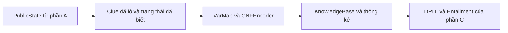

# Báo cáo phần B — Biểu diễn tri thức và Mã hóa CNF (report/B-encoding.md)

Tài liệu này trình bày chi tiết phần biểu diễn tri thức (Knowledge Representation) và mã hóa tự động clue sang dạng chuẩn hội (Conjunctive Normal Form — CNF) của Griductive Solver. Báo cáo tiếp nối mô hình bài toán trong [báo cáo phần A](A-formulation.md), sử dụng cùng quy ước biến mệnh đề, tám loại clue và cơ sở tri thức công khai.

Phần B hiện thực ba thành phần `VarMap`, `CNFEncoder`, `SemanticEvaluator` và bổ sung kiểu dữ liệu dùng chung `KnowledgeBase`. Các phép biến đổi, ví dụ và số lượng biến/mệnh đề dưới đây được đối chiếu với mã nguồn hiện tại. Thuật toán DPLL và việc phân loại hệ quả logic thuộc phần C; vòng lặp agent thuộc phần D.

---

## 1. Mục tiêu và vị trí của phần B trong hệ thống

### 1.1. Mục tiêu

Tại một thời điểm chơi, hệ thống biết trạng thái của một số nhân vật và nội dung các clue đã lộ. Các thông tin này cần được chuyển thành một biểu diễn thống nhất để bộ giải SAT có thể xử lý.

Phần B thực hiện các nhiệm vụ:

1. Ánh xạ xác định giữa các ô và biến mệnh đề chính.
2. Kiểm tra cấu trúc clue và vùng được tham chiếu bằng các hàm dùng chung của phần A.
3. Mã hóa tự động sáu loại clue cơ bản cùng hai mở rộng `PARITY`, `COMPARE`.
4. Biểu diễn trạng thái đã biết bằng mệnh đề đơn vị.
5. Ghép các ràng buộc công khai thành `KnowledgeBase`, thống kê biến và mệnh đề.
6. Đánh giá trực tiếp ngữ nghĩa clue để đối chiếu độc lập với encoder.

Encoder nhận clue có cấu trúc; không cần phân tích ngôn ngữ tự nhiên và không viết sẵn một công thức riêng cho từng puzzle.

### 1.2. Luồng dữ liệu



Việc tạo CNF chưa đưa ra kết luận một nhân vật là Criminal hay Innocent. Phần C sử dụng CNF để kiểm tra SAT/UNSAT và quan hệ kéo theo logic. Phần B cung cấp đầu vào chính xác cho quá trình đó.

---

## 2. Biến mệnh đề và quy ước biểu diễn CNF

### 2.1. Biến chính và ánh xạ row-major

Với bảng $n\times n$, $n\in\{3,4,5\}$, mỗi ô $i$ có một biến chính:

$$
C_i=\begin{cases}
\text{True}, & \text{nhân vật tại }i\text{ là Criminal},\\
\text{False}, & \text{nhân vật tại }i\text{ là Innocent}.
\end{cases}
$$

Với hàng $r$ và cột $c$ đánh số từ 0:

$$
\operatorname{var}(r,c)=rn+c+1.
$$

Ví dụ trên bảng $3\times3$:

| Hàng | Cột A | Cột B | Cột C |
|---|---|---|---|
| 1 | A1 → 1 | B1 → 2 | C1 → 3 |
| 2 | A2 → 4 | B2 → 5 | C2 → 6 |
| 3 | A3 → 7 | B3 → 8 | C3 → 9 |

Biến chính luôn thuộc $1..n^2$. Biến phụ bắt đầu từ $n^2+1$, biểu diễn kết quả tính trung gian và không tương ứng với nhân vật trên bàn.

### 2.2. Literal, clause và CNF

Một literal là biến $C_i$ hoặc phủ định $\neg C_i$. Một clause là phép OR của các literal; công thức CNF là phép AND của các clause:

$$
F=\bigwedge_{j=1}^{q}\left(\bigvee_{\ell\in D_j}\ell\right).
$$

Trong mã nguồn, literal dùng số nguyên có dấu: $+v$ biểu diễn biến $v$, $-v$ biểu diễn phủ định. Ví dụ:

$$
(C_{A1}\lor C_{B1})\land(\neg C_{A1}\lor C_{C1})\land\neg C_{B1}
$$

được biểu diễn bằng:

```python
[[1, 2], [-1, 3], [-2]]
```

`encode_clue()` trả `list[list[int]]`; `KnowledgeBase.clauses` lưu dạng `tuple[tuple[int, ...], ...]` để snapshot không bị sửa tại chỗ.

Hai quy ước biên cần phân biệt:

| Biểu diễn | Ý nghĩa |
|---|---|
| `[]` hoặc `()` | Hội rỗng, tương đương True, không có ràng buộc. |
| `[[]]` hoặc `((),)` | Chứa một clause rỗng, tương đương False, không thể thỏa. |

Không dùng số 0 làm literal. Hằng Boolean trong quá trình xây mạch được rút gọn trước khi ghi clause.

### 2.3. Điều kiện đúng khi có biến phụ

Gọi $\mathbf C$ là các biến chính, $\mathbf Z$ là các biến phụ và $F_c$ là CNF của clue $c$. Yêu cầu đối với một phép gán đầy đủ $\alpha$ lên các ô là:

$$
\operatorname{Semantic}(c,\alpha)=\text{True}
\iff
\exists\beta\colon F_c(\alpha,\beta)=\text{True}.
$$

Nghĩa là phép gán trạng thái nhân vật thỏa clue gốc khi và chỉ khi có thể mở rộng nó bằng giá trị của các biến phụ để thỏa CNF. Không yêu cầu công thức gốc và CNF có cùng tập biến; yêu cầu là bảo toàn chính xác nghiệm khi chiếu về các biến chính.

---

## 3. Thiết kế ánh xạ biến — VarMap

Lớp được hiện thực trong [`Source/logic/varmap.py`](../Source/logic/varmap.py).

| Phương thức/thuộc tính | Chức năng |
|---|---|
| `VarMap(n)` | Kiểm tra $n\in\{3,4,5\}$ và khởi tạo vùng biến phụ. |
| `var(cell)` | Chuyển tọa độ chuẩn thành biến chính theo row-major. |
| `cell(var)` | Ánh xạ ngược biến chính dương thành ô. |
| `new_aux()` | Cấp ID biến phụ mới, tăng dần và không trùng biến đã cấp trong lượt xây hiện tại. |
| `reset_aux()` | Đặt ID phụ kế tiếp về $n^2+1$. |
| `num_primary` | Số biến chính $n^2$. |
| `num_aux` | Số biến phụ đã cấp. |
| `num_vars` | Tổng số biến chính và phụ. |

`cell()` từ chối ID ngoài vùng biến chính, literal âm, Boolean và số thực. `var()` dùng bộ chuyển tọa độ của phần A để từ chối ô sai định dạng hoặc ngoài bảng.

### 3.1. Vòng đời biến phụ

Trong cùng một lượt dựng KB, mỗi clue tiếp tục sử dụng bộ cấp biến hiện tại. Ví dụ clue thứ nhất dùng biến phụ 10, 11 thì clue tiếp theo bắt đầu từ 12. Các CNF riêng lẻ vì thế có thể được nối lại mà không vô tình đồng nhất hai phép tính khác nhau.

`build_kb()` reset một lần trước khi mã hóa toàn bộ danh sách clue. Với cùng kích thước, cùng thứ tự clue và cùng nội dung trạng thái đã biết, kết quả dựng lại là xác định. Thứ tự chèn của mapping trạng thái không ảnh hưởng kết quả vì unit clause được sắp theo biến chính.

Sau khi reset, không được ghép tùy ý CNF cũ với CNF mới dùng chung vùng ID phụ. Snapshot `KnowledgeBase` cũ vẫn dùng độc lập được vì lưu đầy đủ clause và số biến của chính nó.

---

## 4. Mã hóa ba loại clue không đếm

Các phép mã hóa nằm trong [`Source/logic/encoder.py`](../Source/logic/encoder.py). Mỗi clue được kiểm tra bởi `validate_clue(clue, n)` trước khi chuyển đổi.

### 4.1. FACT — xác nhận trạng thái

$$
\operatorname{CNF}(\operatorname{FACT}(i,s))=
\begin{cases}
(C_i), & s=\text{CRIMINAL},\\
(\neg C_i), & s=\text{INNOCENT}.
\end{cases}
$$

Ví dụ `FACT(A1, INNOCENT)` cho `[[-1]]`. Phép mã hóa có một clause, không cần biến phụ.

### 4.2. SAME — hai ô cùng trạng thái

Đặt $a=C_i$, $b=C_j$. Từ ngữ nghĩa tương đương hai chiều:

$$
a\leftrightarrow b
\equiv(a\rightarrow b)\land(b\rightarrow a)
\equiv(\neg a\lor b)\land(a\lor\neg b).
$$

Ví dụ `SAME(A1, B1)`:

```python
[[-1, 2], [1, -2]]
```

| $a$ | $b$ | SAME |
|---|---|---|
| False | False | True |
| False | True | False |
| True | False | False |
| True | True | True |

Đây là ví dụ suy diễn CNF cho clue nhị phân: hai clause loại đúng hai trường hợp khác trạng thái, giữ lại hai trường hợp cùng trạng thái.

### 4.3. DIFFERENT — hai ô khác trạng thái

$$
a\oplus b\equiv(a\lor b)\land(\neg a\lor\neg b).
$$

Clause thứ nhất cấm hai ô cùng Innocent; clause thứ hai cấm hai ô cùng Criminal. `DIFFERENT(A1, B1)` cho `[[1, 2], [-1, -2]]`. SAME và DIFFERENT đều có hai clause, không có biến phụ.

---

## 5. Mã hóa các ràng buộc đếm (Cardinality Constraints)

### 5.1. Ngữ nghĩa và lựa chọn thuật toán

Với vùng $R$ gồm $m$ ô và $x_1,\ldots,x_m$ là các biến tương ứng:

$$
\begin{aligned}
\operatorname{AT\_LEAST}(R,k)&:\quad\sum_{i=1}^{m}x_i\ge k,\\
\operatorname{AT\_MOST}(R,k)&:\quad\sum_{i=1}^{m}x_i\le k,\\
\operatorname{EXACTLY}(R,k)&:\quad\sum_{i=1}^{m}x_i=k.
\end{aligned}
$$

Boolean được hiểu là số 0 hoặc 1 khi tính tổng. Validator yêu cầu $k$ là số nguyên thực sự, không phải `bool`, và $0\le k\le m$.

Encoder hiện tại dùng mạch đếm ngưỡng bằng quy hoạch động. Cách này tránh liệt kê số lượng lớn các tổ hợp ô khi vùng và ngưỡng tăng. Đổi lại, những clue nhỏ có thể sinh nhiều biến/mệnh đề hơn dạng CNF trực tiếp ngắn nhất.

### 5.2. Biến trạng thái đếm ngưỡng

Định nghĩa $S(i,j)$ là “trong $i$ literal đầu, có ít nhất $j$ literal đúng”. Các điều kiện cơ sở:

$$
S(i,0)=\text{True},\qquad S(0,j)=\text{False}\ (j>0).
$$

Công thức truy hồi:

$$
S(i,j)\leftrightarrow S(i-1,j)\lor\left(x_i\land S(i-1,j-1)\right).
$$

Có ít nhất $j$ literal đúng sau khi xét $x_i$ nếu trước đó đã đủ $j$, hoặc $x_i$ đúng và trước đó đã đủ $j-1$.

Thuật toán xây lần lượt các hàng $i=1..m$, chỉ cần các ngưỡng đến $k$ và giữ hai hàng trạng thái. Nó cũng áp dụng với literal âm, cần cho COMPARE: giá trị được đếm là giá trị chân trị của literal, không nhất thiết của biến dương.

### 5.3. Mã hóa cổng bằng tương đương hai chiều

Mỗi cổng trung gian được định nghĩa theo kiểu Tseitin. Với $z\leftrightarrow(a\land b)$:

$$
(\neg z\lor a)\land(\neg z\lor b)\land(z\lor\neg a\lor\neg b).
$$

Với $z\leftrightarrow(a\lor b)$:

$$
(z\lor\neg a)\land(z\lor\neg b)\land(\neg z\lor a\lor b).
$$

Hai chiều bảo đảm biến phụ phản ánh đúng kết quả cổng. Khi các đầu vào đã cố định, đầu ra cũng được xác định, thay vì được tự do chọn một giá trị làm yếu ràng buộc.

Encoder rút gọn hằng True/False, hai đầu vào giống nhau và hai đầu vào phủ định nhau trước khi cấp biến phụ. Khi tạo clause, literal trùng được gộp; clause chứa cả $x$ và $\neg x$ là hằng đúng nên được bỏ. Clause chỉ còn hằng sai trở thành clause rỗng.

### 5.4. Ép đầu ra cho ba loại clue

Sau khi tạo mạch:

| Clue | Điều kiện ép |
|---|---|
| AT_LEAST($R,k$) | $S(m,k)$ đúng. |
| AT_MOST($R,k$) | $S(m,k+1)$ sai. |
| EXACTLY($R,k$) | $S(m,k)$ đúng và $S(m,k+1)$ sai. |

Ngưỡng “ít nhất $k$” với $k\le0$ là True; với $k>m$ là False. Đây là cách xử lý nội bộ cho các biên và cho ngưỡng được biến đổi từ COMPARE; không có nghĩa clue đầu vào được phép có $k$ tùy ý ngoài miền validator.

Ví dụ AT_LEAST(0) và AT_MOST($m$) không bổ sung ràng buộc hữu hiệu; EXACTLY(0) buộc tất cả ô Innocent, EXACTLY($m$) buộc tất cả ô Criminal.

### 5.5. Ví dụ suy diễn EXACTLY(1, {A1, B1})

Đặt $a=C_{A1}$, $b=C_{B1}$. Ngữ nghĩa “đúng một Criminal” là:

$$
(a\lor b)\land\neg(a\land b)
\equiv(a\lor b)\land(\neg a\lor\neg b).
$$

Dạng trực tiếp có hai clause `[[1, 2], [-1, -2]]`. Để minh họa đúng triển khai mạch hiện tại, encoder trên bảng $3\times3$ cấp:

$$
u_{10}\leftrightarrow(a\lor b),\qquad
u_{11}\leftrightarrow(a\lor b),\qquad
u_{12}\leftrightarrow(b\land a).
$$

$u_{10}$ thuộc mạch ngưỡng dưới; $u_{11},u_{12}$ thuộc lượt xây ngưỡng trên. Hai ngưỡng được xây riêng nên có phép tính trung gian lặp lại. Ép $u_{10}$ đúng và $u_{12}$ sai cho đầu ra thực tế:

```python
[
    [10, -1], [10, -2], [-10, 1, 2], [10],
    [11, -1], [11, -2], [-11, 1, 2],
    [-12, 2], [-12, 1], [12, -2, -1], [-12],
]
```

Kết quả có 9 biến chính của bảng, 3 biến phụ và 11 clause. Cách gán $(a,b)=(0,0)$ vi phạm ngưỡng dưới; $(1,1)$ vi phạm ngưỡng trên; $(1,0)$ và $(0,1)$ có thể mở rộng để thỏa CNF. Ví dụ cho thấy tiêu chí đúng là bảo toàn nghiệm trên biến chính, không phải số clause phải bằng dạng trực tiếp.

---

## 6. Mở rộng PARITY — ràng buộc chẵn/lẻ

### 6.1. Ngữ nghĩa và mạch XOR

Với $m$ ô trong vùng:

$$
p=x_1\oplus x_2\oplus\cdots\oplus x_m.
$$

`ODD` ép $p$ đúng, `EVEN` ép $p$ sai. Encoder ghép các phép XOR từ trái sang phải. Mỗi cổng $z\leftrightarrow(a\oplus b)$ được mã hóa bằng:

$$
(a\lor b\lor\neg z)\land(\neg a\lor\neg b\lor\neg z)
\land(a\lor\neg b\lor z)\land(\neg a\lor b\lor z).
$$

Vùng hợp lệ luôn không rỗng. Với một ô, không cần biến phụ: ODD ép chính biến đó đúng, EVEN ép nó sai.

### 6.2. Ví dụ ODD trên hàng 1 của bảng 3×3

Với $a=C_{A1}$, $b=C_{B1}$, $c=C_{C1}$:

$$
u_{10}\leftrightarrow(a\oplus b),\qquad
u_{11}\leftrightarrow(u_{10}\oplus c),\qquad u_{11}=\text{True}.
$$

CNF thực tế:

```python
[
    [1, 2, -10], [-1, -2, -10], [1, -2, 10], [-1, 2, 10],
    [10, 3, -11], [-10, -3, -11], [10, -3, 11], [-10, 3, 11],
    [11],
]
```

Đây là 2 biến phụ và 9 clause, cho phép số Criminal bằng 1 hoặc 3. Tổng quát có $m-1$ biến phụ và $4(m-1)+1$ clause.

---

## 7. Mở rộng COMPARE — so sánh số lượng giữa hai vùng

### 7.1. Xử lý vùng giao nhau

Clue có dạng:

$$
\sum_{i\in L}C_i\quad\operatorname{op}\quad\sum_{j\in R}C_j,
\qquad\operatorname{op}\in\{=,<,\le,>,\ge\}.
$$

Các ô trong $L\cap R$ đóng góp giống nhau ở hai vế, nên được triệt tiêu khi tính hiệu. Điều này tương đương với ngữ nghĩa phần A: các ô giao được tính ở cả hai vế, không bị bỏ khỏi riêng một vế.

Đặt $A=L\setminus R$, $B=R\setminus L$, $t=|B|$. Ta có:

$$
\begin{aligned}
\operatorname{count}(L)-\operatorname{count}(R)
&=\sum_{i\in A}C_i-\sum_{j\in B}C_j\\
&=\sum_{i\in A}C_i+\sum_{j\in B}(1-C_j)-t.
\end{aligned}
$$

Vì $1-C_j$ là giá trị của literal $\neg C_j$, đặt:

$$
T=\sum_{i\in A}C_i+\sum_{j\in B}\neg C_j.
$$

Clue ban đầu trở thành $T\operatorname{op}t$, sử dụng lại bộ mã hóa đếm trên danh sách literal có dấu.

### 7.2. Chuyển đổi năm phép so sánh

| `op` | Ràng buộc sau biến đổi | Ngưỡng dưới | Ngưỡng trên |
|---|---|---|---|
| EQ | $T=t$ | $t$ | $t$ |
| LT | $T\le t-1$ | Không có | $t-1$ |
| LE | $T\le t$ | Không có | $t$ |
| GT | $T\ge t+1$ | $t+1$ | Không có |
| GE | $T\ge t$ | $t$ | Không có |

Nếu $L=R$, danh sách literal sau triệt tiêu rỗng và hiệu luôn bằng 0. EQ, LE, GE trở thành hằng đúng; LT và GT trở thành hằng sai. Encoder xử lý thông qua các điều kiện biên ngưỡng, không cần một phép giải SAT riêng.

### 7.3. Ví dụ hàng 1 nhiều Criminal hơn cột B

Trên bảng $3\times3$:

$$
C_{A1}+C_{B1}+C_{C1}>C_{B1}+C_{B2}+C_{B3}.
$$

Sau khi triệt tiêu B1:

$$
C_{A1}+C_{C1}>C_{B2}+C_{B3}.
$$

Chuyển vế và đổi thành literal:

$$
C_{A1}+C_{C1}+\neg C_{B2}+\neg C_{B3}\ge3.
$$

Encoder vì thế xây AT_LEAST(3) trên `[1, 3, -5, -8]`. Chạy riêng clue này từ bộ cấp biến mới cho 11 biến phụ và 34 clause. ID biến phụ trong KB nhiều clue có thể khác do các clue trước đã sử dụng một phần vùng cấp phát.

---

## 8. Xây dựng cơ sở tri thức công khai

### 8.1. Định nghĩa và API

Ở bước $t$:

$$
KB_t=\left(\bigwedge_{c\in\operatorname{RevealedClues}_t}\operatorname{CNF}(c)\right)
\land\left(\bigwedge_{i\in\operatorname{KnownStatuses}_t}\operatorname{UnitClause}(i,s_i)\right).
$$

Các phương thức chính:

```python
CNFEncoder(n: int | VarMap)
encode_clue(clue: Clue) -> list[list[int]]
unit_clause(cell: Cell, status: Status) -> list[int]
build_kb(clues: Sequence[Clue], known_statuses: Mapping[Cell, Status]) -> KnowledgeBase
```

`unit_clause()` trả một clause, chẳng hạn `[1]`; `encode_clue()` trả một tập clause, chẳng hạn `[[1]]` cho FACT(A1, CRIMINAL).

`build_kb()` kiểm tra clue, chuẩn bị unit clause, từ chối ID clue trùng, reset biến phụ rồi mã hóa và ghép tất cả clause. Nó không gọi SAT solver và không khẳng định KB thu được nhất quán. Một tập clue mâu thuẫn vẫn cần được chuyển thành CNF để phần C phát hiện UNSAT.

### 8.2. KnowledgeBase và thống kê

Kiểu dữ liệu được khai báo trong [`Source/common/types.py`](../Source/common/types.py):

| Trường/thuộc tính | Ý nghĩa |
|---|---|
| `n` | Kích thước bảng. |
| `clauses` | Snapshot các clause dưới dạng tuple lồng nhau. |
| `num_primary` | $n^2$, gồm cả các ô chưa xuất hiện trong clause. |
| `num_aux` | Số biến phụ được cấp trong lần xây này. |
| `num_vars` | `num_primary + num_aux`. |
| `num_clauses` | Số clause thực tế sau rút gọn. |

Với KB rỗng, `num_primary` vẫn bằng $n^2$, `num_aux=0`, `num_clauses=0`. Snapshot cũ không thay đổi khi danh sách clue đầu vào, mapping trạng thái hoặc encoder được sử dụng cho lần xây tiếp theo.

### 8.3. Ranh giới thông tin và ví dụ fixture

```python
from logic import CNFEncoder

state = port.get_public_state()
encoder = CNFEncoder(state.n)
kb = encoder.build_kb(
    tuple(state.revealed_clues.values()),
    state.known_statuses,
)
```

Encoder không nhận `Puzzle`, hidden solution hoặc tham chiếu tới GameEngine. Tuy nhiên, nó không thể tự biết một clue bất kỳ do caller truyền vào đã được lộ hay chưa; tầng tích hợp phải lấy đầu vào từ `PublicState` như trên. Chỉ tạo biến cho toàn bộ ô không làm lộ đáp án: biến của một ô chưa có ràng buộc vẫn có thể nhận cả hai giá trị.

Với fixture `3x3_chain.json`, trạng thái ban đầu chỉ biết A1 Innocent và clue của A1 cho biết B1 Criminal. KB thu được chính xác:

```python
((2,), (-1,))
```

CNF clue được nối trước unit clause; thứ tự clause không ảnh hưởng ngữ nghĩa phép AND. Các clue thuộc B1 và những ô chưa lật không được đưa vào lần xây này.

---

## 9. Bộ đánh giá ngữ nghĩa trực tiếp — SemanticEvaluator

Lớp nằm trong [`Source/logic/evaluator.py`](../Source/logic/evaluator.py):

```python
SemanticEvaluator(n: int)
evaluate(clue: Clue, assignment: Mapping[Cell, bool]) -> bool
```

`assignment` phải chứa đúng toàn bộ $n^2$ ô, mỗi giá trị có kiểu `bool` thực sự. Thiếu/thừa ô, dùng số 0/1 hoặc enum `Status` thay Boolean bị từ chối. `status_to_bool()` cung cấp phép chuyển tường minh khi cần.

Evaluator xử lý trực tiếp:

| Clue | Cách đánh giá |
|---|---|
| FACT | So trạng thái ô với trạng thái yêu cầu. |
| SAME / DIFFERENT | So bằng / khác hai giá trị Boolean. |
| EXACTLY / AT_LEAST / AT_MOST | Đếm số True trong vùng rồi so với $k$. |
| PARITY | Lấy tổng modulo 2 rồi so EVEN/ODD. |
| COMPARE | Đếm riêng từng vùng rồi áp dụng phép so sánh. |

Ví dụ assignment có A1=True, B1=False, C1=True thì EXACTLY(2, ROW 1) là True, PARITY(ROW 1, ODD) là False. Khi so hai vùng giao nhau, evaluator đếm trực tiếp mỗi vùng, trong khi encoder dùng phép triệt tiêu đại số; đây là hai cách kiểm tra cùng một ngữ nghĩa.

Evaluator không gọi `CNFEncoder` hoặc SAT solver. Nó dùng chung kiểu dữ liệu, validator và hàm vùng của phần A. Vì vậy tính độc lập ở đây là độc lập về cách tính ngữ nghĩa clue so với cách dựng CNF, không phải một cài đặt độc lập hoàn toàn của mọi tiện ích tọa độ/vùng.

---

## 10. Lập luận tính đúng và chi phí mã hóa

### 10.1. Tính đúng của từng phép biến đổi

FACT, SAME và DIFFERENT dùng các đẳng thức logic đã suy diễn ở mục 4. Mỗi cổng AND/OR/XOR định nghĩa bằng tương đương hai chiều, nên việc cấp một biến phụ không thêm lựa chọn sai trên các biến chính.

Với mạch đếm, chứng minh quy nạp theo $i$: các hằng cơ sở đúng với tiền tố rỗng; nếu các trạng thái hàng $i-1$ mang đúng nghĩa “ít nhất $j$”, công thức truy hồi phân chia đầy đủ hai khả năng của literal thứ $i$ và tạo đúng hàng $i$. Do đó ép ngưỡng cuối tương ứng chính xác AT_LEAST, AT_MOST hoặc EXACTLY.

Chuỗi XOR bảo toàn chẵn/lẻ sau mỗi bước thêm literal. COMPARE dùng một đẳng thức số học để chuyển về bài toán đếm, nên giữ nguyên nghiệm kể cả khi hai vùng giao nhau.

Khi ghép nhiều clue, mỗi mạch dùng vùng ID phụ riêng. Mọi assignment thỏa tất cả clue đều mở rộng được cho từng mạch; ngược lại, một model của CNF ghép phải thỏa CNF từng clue, nên phép chiếu lên biến chính thỏa tất cả clue và trạng thái đã biết.

### 10.2. Độ phức tạp và đánh đổi

| Thành phần | Chi phí của phần mã hóa sau khi đã phân giải vùng |
|---|---|
| FACT | 1 clause, 0 biến phụ. |
| SAME / DIFFERENT | 2 clause, 0 biến phụ. |
| Một mạch ngưỡng $q$, $1\le q\le m$ | $O(mq)$ cổng, clause và thời gian dựng; hai hàng DP dùng $O(q)$ bộ nhớ ngoài đầu ra. |
| EXACTLY với ngưỡng $k$ | Xây riêng ngưỡng $k$ và $k+1$; chặn trên $O(m^2)$, có thể lặp một số cổng. |
| PARITY | Chính xác $m-1$ biến phụ và $4(m-1)+1$ clause. |
| COMPARE | Mã hóa đếm trên $|L\triangle R|$ literal sau khi triệt tiêu giao. |

Thống kê không bao gồm chi phí giải SAT. Việc phân giải và sắp xếp vùng cũng có chi phí riêng, đặc biệt với vùng EXPLICIT. Encoder hiện tại ưu tiên một cách mã hóa thống nhất, dễ kiểm chứng; chưa chia sẻ cổng giữa hai ngưỡng, chưa cache clue và chưa chọn dạng mã hóa khác nhau theo kích thước vùng.

### 10.3. Số lượng đầu ra đo trực tiếp

Bảng sau được sinh bằng `CNFEncoder(n).build_kb([clue], {})`, mỗi hàng chỉ có một clue, không có trạng thái đã biết:

| Bảng | Clue trên bảng đó | Biến chính | Biến phụ | Tổng biến | Clause |
|---|---|---:|---:|---:|---:|
| 3×3 | EXACTLY(4, toàn bảng) | 9 | 103 | 112 | 311 |
| 4×4 | EXACTLY(8, toàn bảng) | 16 | 367 | 383 | 1103 |
| 5×5 | EXACTLY(12, toàn bảng) | 25 | 887 | 912 | 2663 |
| 3×3 | PARITY(EVEN, toàn bảng) | 9 | 8 | 17 | 33 |
| 4×4 | PARITY(EVEN, toàn bảng) | 16 | 15 | 31 | 61 |
| 5×5 | PARITY(EVEN, toàn bảng) | 25 | 24 | 49 | 97 |
| 3×3 | count(toàn bảng) > count(hàng 1) | 9 | 5 | 14 | 16 |
| 4×4 | count(toàn bảng) > count(hàng 1) | 16 | 11 | 27 | 34 |
| 5×5 | count(toàn bảng) > count(hàng 1) | 25 | 19 | 44 | 58 |

Trong ba hàng COMPARE, hàng 1 là tập con của toàn bảng nên ràng buộc tương đương có ít nhất một Criminal ngoài hàng 1. Các con số là kích thước biểu diễn hiện tại, không phải benchmark thời gian giải puzzle hay bằng chứng CNF đã tối ưu số clause.

---

## 11. Phương pháp kiểm thử và kết quả nghiệm thu

### 11.1. Ba cách đối chiếu

Bộ kiểm thử trong [`Source/tests/test_encoder_acceptance.py`](../Source/tests/test_encoder_acceptance.py) dùng ba cách bổ trợ:

1. **Oracle ngữ nghĩa:** `tests/oracles.py` đánh giá trực tiếp clue, dùng làm kết quả tham chiếu cho evaluator sản phẩm và CNF.
2. **Vét cạn CNF ở ca nhỏ:** liệt kê model bao gồm biến phụ, chiếu về biến chính rồi so với các assignment thỏa ngữ nghĩa. Hàm oracle CNF giới hạn tối đa 16 biến tổng cộng.
3. **Lan truyền đơn vị ở mạch lớn:** cố định toàn bộ biến chính rồi lan truyền trên mạch tương đương không chu trình. Nếu có clause rỗng thì không thỏa; nếu không còn clause thì thỏa. Nếu còn clause chưa quyết định mà không còn unit, test báo lỗi thay vì tùy ý giả định SAT.

Các mạch lớn được kiểm tra theo cách thứ ba không sử dụng DPLL sản phẩm. Do các cổng có đầu vào đã cố định và được định nghĩa hai chiều, các đầu ra được xác định dần. Đây là phương pháp kiểm tra các mạch đã xây, không phải một SAT solver tổng quát.

### 11.2. Phạm vi 11 nhóm kiểm tra G-B

| Mã test | Nội dung thực tế |
|---|---|
| B01 | Song ánh VarMap trên 3×3, 4×4, 5×5; cấp/reset biến phụ; từ chối ID và kích thước sai. |
| B02 | FACT cho hai trạng thái; SAME và DIFFERENT; mỗi clue xét đủ 512 assignment 3×3. |
| B03 | Ba loại counting trên vùng 1, 3, 9 ô; mọi $k$ từ 0 đến kích thước vùng; mỗi clue xét đủ 512 assignment. |
| B04 | EVEN/ODD với vùng hàng, cột, hàng xóm và một ô explicit; xét đủ 512 assignment. |
| B05 | Cả năm phép COMPARE trên vùng giao, trùng, rời và quan hệ tập con theo hai chiều; xét đủ 512 assignment mỗi clue. |
| B06 | Vét cạn cả biến phụ cho ba ca nhỏ: EXACTLY, PARITY và COMPARE; so tập model đã chiếu. |
| B07 | KB ghép counting, parity và trạng thái đã biết; dựng lại xác định; snapshot cũ độc lập; KB rỗng và dấu unit clause. |
| B08 | Mã hóa liên tiếp không tái sử dụng biến phụ; ghép ODD và EVEN trên cùng vùng phải mâu thuẫn. |
| B09 | Từ chối clue/assignment sai kiểu, vùng trùng ô, tọa độ ngoài bảng và ID clue trùng. |
| B10 | Bảng 4×4, 5×5: mỗi kích thước có hai assignment biên và 20 assignment giả ngẫu nhiên, seed 2026; kiểm tra EXACTLY, PARITY, COMPARE và giới hạn kích thước CNF. |
| B11 | Từ PublicState ban đầu của fixture chain, KB chỉ chứa FACT(B1=CRIMINAL) và A1=INNOCENT. |

Ngoài 11 test trên, `test_runner_rejects_broken_real_encoder` trong [`test_harness_faults.py`](../Source/tests/test_harness_faults.py) cố tình thay `encode_clue()` bằng hàm trả CNF rỗng. Runner phải phát hiện sai phạm, trả FAIL và exit code 1. Kiểm tra thiếu module được mô phỏng riêng để tiếp tục hoạt động sau khi mã B đã được thêm.

### 11.3. Kết quả đã ghi nhận

Theo [`verification/results.json`](../verification/results.json), lần nghiệm thu toàn hệ thống ngày 05/11/2026, với `scope=all`, `require_real=true` ghi nhận:

| Phạm vi | Kết quả |
|---|---|
| G-A | PASS, 7/7 subcheck. |
| G-B | PASS, 11/11 subcheck, không có FAIL hoặc BLOCKED trong B. |
| G-C, G-P, G-D, G-E, G-I | BLOCKED vì các phần còn thiếu/chưa tích hợp. |
| Toàn hệ thống | BLOCKED, exit code 2. |

Lần chạy pytest toàn bộ đã ghi nhận **40 passed, 6 skipped**. Sáu test bị bỏ qua thuộc C, D, E và tích hợp; không có test B bị bỏ qua. Số 11 là số nhóm test của B, không phải chỉ có 11 cách gán được kiểm tra.

### 11.4. Lệnh tái lập

Từ thư mục gốc repo:

```powershell
cd Source
python -m pytest tests/test_encoder_acceptance.py -v
python -m tools.verify_project --scope b --require-real --output ../verification
```

Kiểm tra hồi quy và toàn hệ thống:

```powershell
python -m pytest tests -q
python -m tools.verify_project --scope all --require-real --output ../verification
```

Lệnh nghiệm thu ghi đè `results.json` và `summary.md` trong thư mục output bằng kết quả của scope vừa chạy. Khi C–E còn thiếu, scope B có thể PASS trong khi scope all vẫn BLOCKED. Exit code 0 là PASS, 1 là có FAIL, 2 là không có FAIL nhưng còn BLOCKED.

---

## 12. Đối chiếu yêu cầu bàn giao và phạm vi hoàn thành

| Yêu cầu phần B trong handoff-A | Hiện thực và bằng chứng |
|---|---|
| VarMap ánh xạ song ánh và tách biến phụ | `logic/varmap.py`; B01, B08. |
| Mã hóa sáu clue cơ bản và hai mở rộng | `CNFEncoder.encode_clue()`; B02–B06, B10. |
| Tạo mệnh đề đơn vị từ trạng thái | `CNFEncoder.unit_clause()`; B07, B11. |
| Dựng KnowledgeBase từ clue và trạng thái đã biết | `CNFEncoder.build_kb()`, `common.types.KnowledgeBase`; B07, B11. |
| Evaluator trực tiếp, không gọi encoder | `logic/evaluator.py`; đối chiếu trong các nhóm test ngữ nghĩa. |
| Dùng types, regions, validation của A | Import từ `common/`, kiểm tra trước khi mã hóa; B09. |
| Lệnh nghiệm thu B và báo cáo kết quả | `IntegrationRunner.run_gate_b()`, CLI `verify_project`, G-B PASS. |

Phần B đã cung cấp biểu diễn logic để phần C nhận `kb.clauses` và `kb.num_vars`. Việc kiểm tra KB nhất quán, phân loại Criminal/Innocent/Unknown, kiểm tra nghiệm duy nhất, tự động lật bài và giao diện vẫn thuộc các phần tiếp theo.

Các giới hạn hiện tại cần được giữ rõ khi ghép vào báo cáo chung:

- Kiểm tra 3×3 vét cạn assignment cho các clue được chọn, không liệt kê mọi clue hợp lệ có thể tạo ra.
- Kiểm tra 4×4/5×5 là kiểm tra mẫu và biên, không vét cạn $2^{16}$ hoặc $2^{25}$ assignment.
- Encoder và evaluator dùng chung tiện ích vùng của A; lỗi chung ở lớp này cần kiểm thử A để phát hiện bổ sung.
- CNF counting có thể lớn; hai ngưỡng EXACTLY chưa chia sẻ cổng, chưa có tối ưu theo từng trường hợp.
- Caller chịu trách nhiệm chỉ cung cấp thông tin công khai; encoder không xác thực nguồn gốc một clue tùy ý.
- Chưa có số liệu SAT calls, decisions, propagations, backtracks hoặc runtime giải hoàn chỉnh trong phạm vi B.

---

## 13. Các tệp triển khai và tài liệu liên quan

| Tệp | Nội dung |
|---|---|
| [`Source/logic/varmap.py`](../Source/logic/varmap.py) | Ánh xạ biến và cấp phát biến phụ. |
| [`Source/logic/encoder.py`](../Source/logic/encoder.py) | Tám phép mã hóa, cổng logic và xây KB. |
| [`Source/logic/evaluator.py`](../Source/logic/evaluator.py) | Đánh giá trực tiếp ngữ nghĩa clue. |
| [`Source/logic/__init__.py`](../Source/logic/__init__.py) | Export ba lớp của phần B. |
| [`Source/common/types.py`](../Source/common/types.py) | Kiểu KnowledgeBase dùng chung với phần C/D. |
| [`Source/tests/test_encoder_acceptance.py`](../Source/tests/test_encoder_acceptance.py) | 11 nhóm kiểm tra B. |
| [`Source/tools/integration_runner.py`](../Source/tools/integration_runner.py) | Chạy cổng G-B thật và tổng hợp trạng thái. |
| [`docs/handoff-B.md`](../docs/handoff-B.md) | Constructor, API và hướng dẫn tích hợp. |
| [`report/A-formulation.md`](A-formulation.md) | Mô hình bài toán, ngữ nghĩa clue và reveal protocol. |
| [`report/ai-usage.md`](ai-usage.md) | Ghi nhận hỗ trợ AI trong quá trình triển khai B. |
